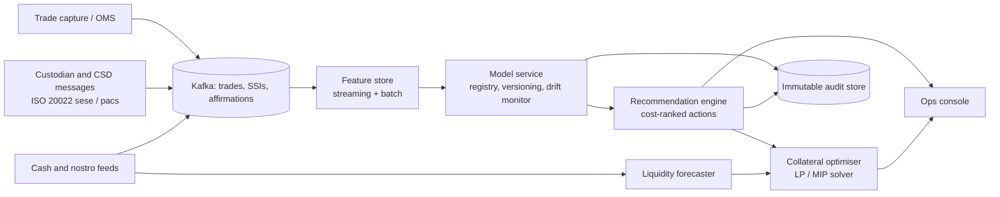

# SettleSight: T+1 Settlement Risk and Liquidity Control Tower

A working prototype of an operations console for custody and clearing banks (BNY, JPMorgan, State Street, Citi and similar). It predicts which trades will fail to settle **before cutoff**, shows the cash impact, recommends the cheapest fix, optimises collateral, and records an audit trail explaining every alert.

> **All data is synthetic.** There is no connection to any bank system. Cost rates are illustrative.

## Run it
```bash
python3 src/build.py        # simulates data, trains the model, writes dist/index.html + data/
open dist/index.html        # self-contained dashboard, no server or internet needed
```
No dependencies beyond Python 3.8+.

## What is inside
| Module | What it does | Where |
|---|---|---|
| Simulator | 6,000 historical and 140 live trades with counterparty, security, SSI, affirmation and timing features | `src/build.py` |
| Risk model | Logistic regression trained by gradient descent. Every score is `bias + sum(feature contributions)`, so it is explainable by construction | `src/build.py` |
| Validation | Holdout AUC about 0.87 against a 5.9% base fail rate | printed on build |
| Recommendations | Top driver maps to an action. Expected saving = P(fail) x cost x 70% rescue rate | `ACTION` map |
| Liquidity | Hourly cash position with a stress case where at-risk receipts fail, plus buffer breach warning | dashboard |
| Collateral | Cheapest-to-deliver allocation under haircuts and venue eligibility vs naive largest-first | dashboard |
| ISO 20022 | Each trade shows a matching sese.023 style instruction | dashboard |
| Audit trail | Timestamp, model version, score, drivers, action, status | `data/audit_log.jsonl` |

## Architecture (production target)

Key choices: event streaming for sub-minute freshness (T+1 leaves hours, not days); a feature store so training and serving use identical features; a model registry with champion/challenger for model-risk governance (SR 11-7 style); an append-only audit store.

## Business case (illustrative)
Today's simulated book: see the dashboard KPIs. Scaling the simulated saving to a real custodian: a bank processing 50,000 trades a day at a 5% fail rate has about 2,500 fails a day. If earlier action prevents even one in four, with an average avoided cost of a few hundred dollars each, that is on the order of $0.2m to $0.5m a year in direct costs, before funding, penalty and client-experience effects, which are usually larger. Replace these assumptions with real fail-cost data before presenting externally.

## Limits to state honestly
- Labels are generated from a hidden formula, so the AUC shows the pipeline works, not real-world accuracy.
- The collateral optimiser is greedy. A production system would use a MIP solver.
- No authentication, entitlements or real message ingestion.

## Suggested next steps
1. Replace the simulator with public data (DTCC/FINRA fail statistics, SEC T+1 materials).
2. Swap logistic regression for gradient boosting with SHAP, and compare on calibration.
3. Add a FastAPI service and a Kafka replay demo.
4. Record a 2 minute walkthrough video.

## Resume bullets
- Built a T+1 settlement-fail prediction and liquidity control tower with an explainable model (AUC 0.87 on synthetic holdout), cost-ranked actions and an audit trail.
- Designed a streaming architecture (Kafka, feature store, model registry) and a cheapest-to-deliver collateral optimiser that cut simulated daily funding cost by about 33%.
